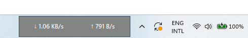
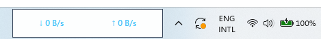

# Win11 Net Speed Compact

A small, always-on-top network speed meter for Windows 11. It sits on or near the taskbar and shows live download (↓) and upload (↑) speed, with no telemetry, no admin rights and no network requests.

Developed by [Iqbal Mahmud](https://iqbalmahmud.com) · Current version: **[1.0.0](https://github.com/iqbalmbadhan/Win11NetSpeedCompact/releases/tag/v1.0.0)** · [Changelog](CHANGELOG.md)

<p align="center">
  
</p>

| Default dark theme | Custom theme |
| --- | --- |
|  |  |

## Features

- Live download and upload speed, refreshed twice per second
- Auto-scaling units in bytes (B/s → GB/s) or bits (bps → Gbps), or fixed MB/s, Mbps, KB/s or Kbps
- Monitor all network interfaces combined, or a single adapter
- Custom font color, weight and size, plus a custom background color
- Drag to move it anywhere, and resize it with Ctrl + mouse wheel
- Stays above the taskbar and other windows
- System tray icon with **Bring to front** and **Exit**
- Optional **Start with Windows** for the current user only
- Remembers position, size and appearance between sessions
- Single-instance guard, so launching it twice does not open a second copy

## Requirements

- Windows 11
- Using the EXE: nothing else
- Running from source: Python 3.10+ (CI builds with 3.12) with the `py` launcher, and the packages in [`requirements.txt`](requirements.txt): `psutil`, `Pillow` and `pystray`

## Installation

### Option A: Download the EXE (recommended)

1. Download `Win11NetSpeedCompact.exe` and `Win11NetSpeedCompact.exe.sha256.txt` from the [v1.0.0 release](https://github.com/iqbalmbadhan/Win11NetSpeedCompact/releases/tag/v1.0.0). A copy is also kept in the [`dist`](dist) folder of this repository.
2. [Verify the checksum](#verifying-downloads).
3. Move the EXE to a permanent folder, for example `%LOCALAPPDATA%\Programs\Win11NetSpeedCompact\`, and double-click it.

The EXE is not code-signed yet, so Windows SmartScreen may show "Windows protected your PC". If the checksum matches, choose **More info → Run anyway**.

### Option B: Run from source

1. Clone or download this repository and keep it in a permanent folder.
2. Double-click **`install_and_run.bat`**. It installs the dependencies and starts the widget.
3. After that, start it with **`run_widget.bat`**.

To do the same from a terminal:

```powershell
py -m pip install -r requirements.txt
pyw src\widget.py
```

## First launch

- The widget appears next to the notification area on the taskbar.
- **Start with Windows** is turned on automatically the first time it launches. You can turn it off from the right-click menu at any time.
- If you later move the folder or EXE, launch it once from the new location and the startup entry will point to the new path.

## Usage

| Action | How |
| --- | --- |
| Move the widget | Left-click and drag anywhere on it |
| Resize | Hold **Ctrl** and scroll the mouse wheel over the widget |
| Open settings | Right-click the widget |
| Bring it back on top | Click the tray icon, or right-click it and choose **Bring to front** from its menu |
| Quit | Right-click → **Exit**, or tray icon → **Exit** |

### Right-click menu

| Menu item | What it does |
| --- | --- |
| Speed unit | Auto bytes, Auto bits, MB/s, Mbps, KB/s or Kbps |
| Network interface | All interfaces, or one adapter that is currently up |
| Font color | Preset colors (white, black, blue, green, purple, orange) or Custom… |
| Font weight | Normal, Semi-bold or Bold |
| Font size | 8 to 12 pt |
| Background color… | Choose any background color |
| Reset position to taskbar | Moves the widget back next to the notification area |
| Start with Windows | Turns auto-start on or off for your user account |
| Open iqbalmahmud.com | Opens the developer's website in your browser |
| Exit | Closes the widget and removes the tray icon |

## Configuration

Settings are saved as JSON in:

```
%APPDATA%\Win11NetSpeedCompact\settings.json
```

Most settings change from the menu. A few advanced values can only be changed by editing the file while the widget is closed:

| Key | Default | Description |
| --- | --- | --- |
| `interval_ms` | `500` | How often the speed updates, in milliseconds (minimum 200) |
| `opacity` | `0.96` | Window opacity, from `0.0` to `1.0` |
| `topmost_refresh_ms` | `1500` | How often the widget re-asserts always-on-top (minimum 500) |
| `border` | `#334155` | Border color |
| `width` / `height` | `220` / `42` | Widget size in pixels (minimum 150 × 30) |

To reset everything to the defaults, delete `settings.json`.

## Privacy and security

- Reads only local network byte counters (via `psutil`) and its own settings file.
- Makes **no** HTTP or API requests, sends **no** telemetry and collects **no** browsing data.
- Runs as the signed-in user and never requests administrator privileges.
- Writes exactly one registry value, `Win11NetSpeedCompact`, under `HKCU\Software\Microsoft\Windows\CurrentVersion\Run`, and only when Start with Windows is on.
- On launch, removes the `Win11NetSpeedWidgetPro` startup value left by earlier builds of this project. It does not touch any other startup entries.
- Opens a web page only when you choose **Open iqbalmahmud.com**.

To report a vulnerability, see [SECURITY.md](SECURITY.md).

## Verifying downloads

Each EXE comes with a SHA-256 checksum file. Use the checksum from the same place you downloaded the EXE, because the release and the `dist` folder hold separate builds. In PowerShell, from the folder that contains the download:

```powershell
(Get-FileHash .\Win11NetSpeedCompact.exe -Algorithm SHA256).Hash.ToLower()
Get-Content .\Win11NetSpeedCompact.exe.sha256.txt
```

The two hashes must match exactly. If they do not, do not run the file.

## Upgrading from older versions

If you used an earlier build of this widget (such as "Net Speed Widget Pro"), exit it before starting this version, so that two widgets don't run at the same time. The old startup entry is cleaned up automatically.

## Uninstall

1. Right-click the widget and choose **Exit**.
2. Run [`scripts\uninstall.bat`](scripts/uninstall.bat). It removes the startup entry and the settings folder.
3. Delete the EXE or the project folder.

If you only have the EXE, you can do step 2 manually by turning off **Start with Windows** before exiting and then deleting `%APPDATA%\Win11NetSpeedCompact`.

## Building from source

Requires Windows and Python with the `py` launcher.

| Script | Output |
| --- | --- |
| `scripts\build_exe.bat` | `dist\Win11NetSpeedCompact.exe` |
| `scripts\build_release.bat` | The EXE plus `dist\Win11NetSpeedCompact.exe.sha256.txt` |
| `scripts\sign_release.ps1` | Signs the EXE with a PFX certificate, then verifies it and regenerates the checksum |

Both build scripts install the requirements and PyInstaller, then build a single-file windowed EXE.

### Automated releases

[`.github/workflows/build.yml`](.github/workflows/build.yml) builds the EXE and its checksum on `windows-latest`. To run it, open the repository's **Actions** tab, choose **Build and Release Windows EXE** and click **Run workflow**. The EXE and checksum can then be downloaded from the run's artifacts.

Code-signing setup and the repository secrets it needs are described in [DISTRIBUTION.md](DISTRIBUTION.md).

## Project structure

```
├── dist/                      # Prebuilt EXE + SHA-256 checksum
├── src/widget.py              # The whole application (Tkinter + psutil + pystray)
├── install_and_run.bat        # Install dependencies and launch from source
├── run_widget.bat             # Launch from source
├── requirements.txt
├── scripts/
│   ├── build_exe.bat          # Build the EXE
│   ├── build_release.bat      # Build the EXE + SHA-256 checksum
│   ├── sign_release.ps1       # Authenticode-sign the EXE
│   └── uninstall.bat          # Remove the startup entry and settings
├── screenshots/
├── .github/workflows/build.yml
├── CHANGELOG.md
├── DISTRIBUTION.md
└── SECURITY.md
```

## Troubleshooting

| Problem | Fix |
| --- | --- |
| Nothing happens when I run `run_widget.bat` | The dependencies are probably missing. Run `install_and_run.bat` once. |
| `'py' is not recognized` | Install Python from [python.org](https://www.python.org/downloads/windows/) with the **py launcher** option ticked. |
| The widget is off-screen or hidden | Right-click the tray icon → **Bring to front**, then right-click the widget → **Reset position to taskbar**. If it is still off-screen, delete `settings.json`. |
| Speed always shows 0 | Choose **Network interface → All interfaces**, or pick the adapter you actually use. |
| Launching again does nothing | Only one copy runs at a time. The widget is already running, so look for its tray icon. |
| It doesn't start with Windows | Make sure **Start with Windows** is ticked, then launch the widget once from its current location. |

## License

[MIT](LICENSE) © 2026 Iqbal Mahmud
